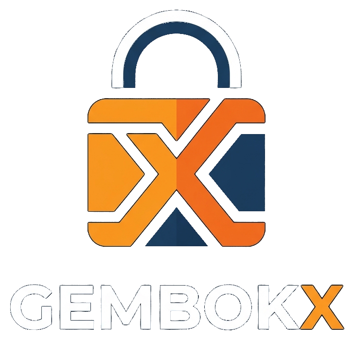
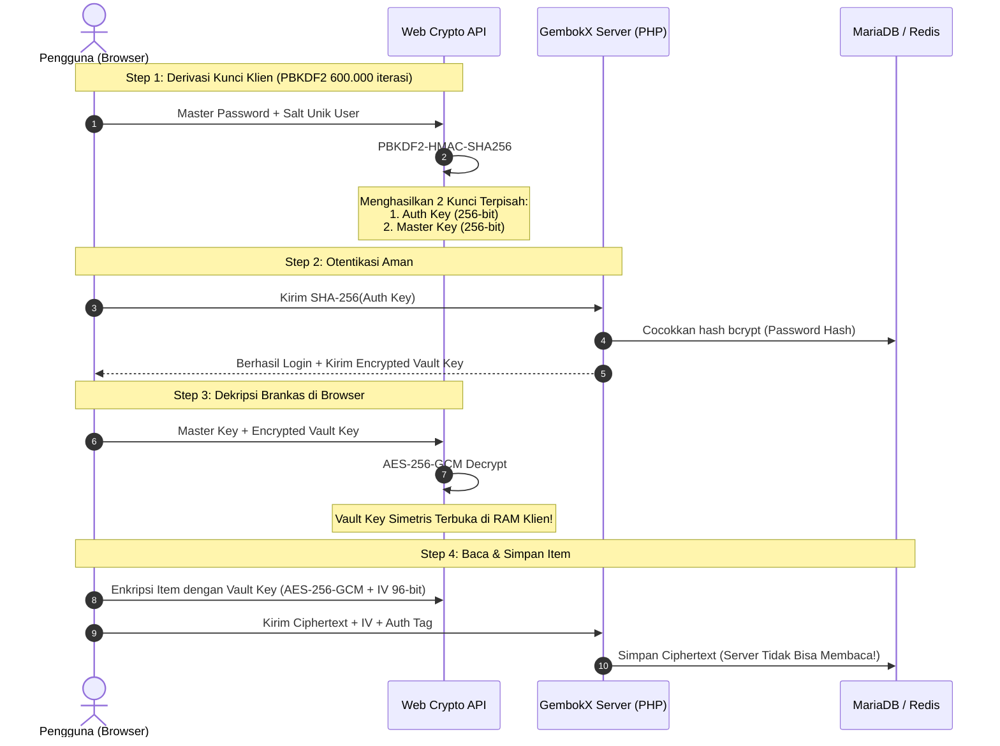

# 🔐 GembokX — Enterprise-Grade Zero-Knowledge Password Manager

<div align="center">



**GembokX** adalah aplikasi manajemen kata sandi pribadi (*Personal & Team Password Manager*) mandiri (*self-hosted*) dengan arsitektur **True Zero-Knowledge Client-Side Encryption**, performa tinggi berbasis **Redis Cache & DB Indexing**, dukungan **WebAuthn Biometric Unlock**, **HaveIBeenPwned k-Anonymity**, **Burn-After-Reading Secret Sharing**, **Printable Emergency Kit**, **PWA**, serta **Browser Extension (Manifest V3)**.

[](https://php.net)
[](https://mariadb.org)
[](https://redis.io)
[](#-arsitektur-kriptografi-zero-knowledge)
[](#-arsitektur-kriptografi-zero-knowledge)
[](#-ekstensi-browser-companion-manifest-v3)
[](#-fitur-utama)

</div>

---

## 📑 Daftar Isi
1. [Arsitektur Kriptografi Zero-Knowledge](#-arsitektur-kriptografi-zero-knowledge)
2. [Fitur Utama](#-fitur-utama)
3. [Performa: Redis Cache & Database Indexing](#-performa-redis-cache--database-indexing)
4. [Ekstensi Browser Companion (Manifest V3)](#-ekstensi-browser-companion-manifest-v3)
5. [Panduan Instalasi Cepat](#-panduan-instalasi-cepat)
   - [Opsi 1: XAMPP / Local Server](#opsi-1-instalasi-di-xampp-windows--macos--linux)
   - [Opsi 2: Docker Compose (Web + MariaDB + Redis)](#opsi-2-menjalankan-dengan-docker-compose)
6. [Struktur Proyek](#-struktur-proyek)
7. [Konfigurasi Environment (.env)](#-konfigurasi-environment-env)
8. [Verifikasi Keamanan Klien](#-verifikasi-keamanan-klien)
9. [Lisensi & Kontribusi](#-lisensi--kontribusi)

---

## 🛡️ Arsitektur Kriptografi Zero-Knowledge

Prinsip dasar GembokX adalah: **Server hanyalah media penyimpanan ciphertext buta (*blind storage*)**. Master Password Anda **TIDAK PERNAH** dikirimkan, diproses, atau disimpan di server. Seluruh proses derivasi kunci, enkripsi, dan dekripsi terjadi 100% di browser pengguna melalui **Web Crypto API**.



### Spesifikasi Kriptografi:
- **KDF (Key Derivation Function):** PBKDF2 dengan HMAC-SHA256 dan **600.000 iterasi** (standar rekomendasi OWASP terbaru).
- **Enkripsi Simetris:** AES-256-GCM (Galois/Counter Mode) dengan IV 96-bit acak per-item dan tag integritas 128-bit untuk mencegah *ciphertext tampering*.
- **Emergency Recovery Code:** Kunci pemulihan 128-bit berkekuatan tinggi yang di-hash bcrypt di server untuk situasi darurat.

---

## ✨ Fitur Utama

### 1. 🗄️ Brankas Multi-Kategori (Vault)
- Simpan kredensial **Login Akun**, **Catatan Rahasia (Secure Notes)**, **Kartu Kredit/Debit**, dan **Identitas Pribadi**.
- Fitur Favorit, Filter Kategori instan, pencarian cepat, dan organisasi berbasis Folder.

### 2. ⚡ Redis Cache & DB Indexing
- **Redis Acceleration:** Cache memori ultra-cepat untuk profil pengguna, sesi, dan status sistem dengan latensi < 0.5ms.
- **Resilient Fallback:** Memiliki engine client RESP murni berbasis socket PHP, sehingga otomatis beralih (*graceful fallback*) ke file cache jika Redis tidak aktif tanpa menimbulkan error.
- **Database B-Tree Indexing:** Indeks komposit optimal pada tabel `users`, `vault_items`, `folders`, `shared_items`, dan `secret_links`.

### 3. 👆 WebAuthn Biometric Unlock
- Buka brankas instan menggunakan **Windows Hello**, **Apple Touch ID / Face ID**, atau sensor sidik jari perangkat.
- Kunci brankas dienkripsi lokal dengan kunci kredensial WebAuthn yang terikat pada hardware authenticator.

### 4. 🕵️ HaveIBeenPwned (HIBP) k-Anonymity Dark Web Checker
- Periksa apakah kata sandi Anda pernah bocor dalam kebocoran data (*data breach*) global.
- Menggunakan model privasi **k-Anonymity**: Hanya 5 karakter pertama dari hash SHA-1 yang dikirim ke API publik. Sisa 35 karakter dicocokkan secara lokal di browser Anda.

### 5. 🔗 Burn-After-Reading Secrets & Peer Sharing
- **Burn-After-Reading Links:** Buat tautan berbagi sekali lihat (*one-time view*) dengan batas waktu kadaluarsa (1 jam s/d 7 hari). Kunci dekripsi diletakkan di **URL Hash Fragment (`#key`)** yang menurut standar RFC browser tidak pernah dikirim ke web server.
- **Peer Sharing:** Bagikan kredensial langsung antar akun pengguna GembokX secara aman.

### 6. 🖨️ Printable Emergency Kit PDF
- Lembar pemulihan fisik berstandar perbankan yang dapat dicetak atau disimpan sebagai PDF di menu `/emergency-kit`.
- Memuat QR Code login, Recovery Key darurat, Token verifikasi, dan instruksi pembukaan brankas.

### 7. ⏱️ Auto-Clear Clipboard
- Lindungi clipboard dari aplikasi lain (*clipboard snooping*).
- Otomatis menghapus sandi yang baru saja disalin setelah interval yang dapat diatur (15 detik, 30 detik, 60 detik) dengan visual countdown toast.

### 8. 📱 Progressive Web App (PWA)
- Dapat diinstal langsung (*Install App*) di Android, iOS, Windows, macOS, dan Linux.
- Dilengkapi manifest modern, ikon adaptif, dan Service Worker cache.

### 9. 👥 User Manager & Administrator Dashboard
- Menu khusus Administrator untuk mendaftarkan akun teman/tim secara langsung dengan pasangan kunci enkripsi Zero-Knowledge.
- Manajemen peran (*Admin* / *User*), aktivasi akun, dan pemantauan log audit keamanan.

### 10. 🖼️ Smart 10MB Avatar Auto-Compression
- Unggah foto profil hingga ukuran **10 Megabytes**.
- Otomatis dipotong simetris 1:1 (*square crop*) dan dikompresi menjadi format **WebP ultra-ringan (< 40 KB)** menggunakan Canvas API browser dan PHP GD engine.

### 11. 🔐 Two-Factor Authentication (2FA TOTP)
- Kompatibel dengan Google Authenticator, Microsoft Authenticator, Authy, dan 1Password melalui scan Barcode QR instan.

---

## ⚡ Performa: Redis Cache & Database Indexing

GembokX dirancang untuk menangani beban tinggi dengan latensi serendah mungkin:

### Indeks Database yang Diterapkan:
| Tabel | Indeks | Kolom | Tujuan Optimasi |
|---|---|---|---|
| `users` | `idx_user_username` | `(username)` | Mempercepat login via username tanpa full-table scan |
| `users` | `idx_user_role_status` | `(role, is_active)` | Filter instan query dashboard dan user manager |
| `users` | `idx_user_created_at` | `(created_at)` | Sorting kronologis daftar pengguna |
| `vault_items` | `idx_vault_user_folder` | `(user_id, folder_id)` | Query item per folder |
| `vault_items` | `idx_vault_user_updated` | `(user_id, updated_at)` | Sorting item terbaru / baru diubah |
| `vault_items` | `idx_vault_favorite` | `(user_id, is_favorite)` | Filter tab favorit seketika |
| `shared_items` | `idx_share_recipient_created` | `(recipient_id, created_at)` | Memuat kotak masuk sandi terbagi |
| `secret_links` | `idx_secret_expiry` | `(expires_at, views_left)` | Pembersihan otomatis secret yang terbakar/kadaluarsa |

### Arsitektur Redis Caching:
```
Request Datang -> SessionService::user()
                      │
           ┌──────────┴──────────┐
      [Cache Hit]           [Cache Miss]
           │                     │
  Baca dari Redis (0.3ms)   Query MariaDB
           │                     │
           │                Simpan ke Redis (TTL 60s)
           └──────────┬──────────┘
                      ▼
               Respon Cepat Ke Klien
```

---

## 🔌 Ekstensi Browser Companion (Manifest V3)

GembokX menyertakan ekstensi browser lengkap yang siap dimuat ke **Google Chrome**, **Microsoft Edge**, **Brave**, dan **Opera**:

### Cara Memasang Ekstensi:
1. Buka browser Anda dan akses `chrome://extensions/` (atau `edge://extensions/`).
2. Nyalakan tombol **Developer mode** di pojok kanan atas.
3. Klik tombol **Load unpacked** (Muat ekstensi yang belum dibongkar).
4. Pilih folder `extension` di dalam direktori GembokX Anda (`d:\xampp\htdocs\pwd\extension`).
5. Ekstensi **GembokX Companion** siap digunakan dari toolbar browser!

---

## 🚀 Panduan Instalasi Cepat

### Opsi 1: Instalasi di XAMPP (Windows / macOS / Linux)

1. **Unduh atau Clone Repositori:**
   ```bash
   git clone https://github.com/frambudi75/PassVault.git
   ```
   Pindahkan folder proyek ke `C:\xampp\htdocs\pwd` (atau folder `htdocs` XAMPP Anda).

2. **Jalankan Apache & MySQL di XAMPP Control Panel.**

3. **Konfigurasi Environment:**
   Salin file `.env.example` menjadi `.env`:
   ```bash
   cp .env.example .env
   ```
   *Secara default, pengaturan `.env` sudah sesuai untuk XAMPP (Host: `127.0.0.1`, Port: `3306`, User: `root`, Password kosong).*

4. **Buka Browser:**
   Akses:
   ```
   http://localhost/pwd/
   ```
   Database `passvault_db`, seluruh tabel, dan indeks performa akan **otomatis dibuat** saat aplikasi pertama kali dibuka (*Zero-Config Auto-Migration*).

---

### Opsi 2: Menjalankan dengan Docker Compose

GembokX menyertakan konfigurasi container multi-layanan (**PHP-FPM/Nginx + MariaDB 10.11 + Redis 7**):

```bash
# 1. Masuk ke direktori proyek
cd GembokX

# 2. Build dan jalankan seluruh container
docker-compose up -d --build

# 3. Akses GembokX di browser:
# http://localhost:2035
```

---

### 👤 Akun Pengguna & Seeder Demo

#### 1. Instalasi Baru (Fresh / Production):
- Database dimulai dalam kondisi **bersih tanpa akun bawaan** (`0 users`).
- Silakan buka halaman login dan klik **Daftar Akun Baru** (`/register`) untuk membuat akun pribadi Anda.
- **Hak Akses Admin:** Pengguna pertama yang mendaftar otomatis ditetapkan sebagai **Administrator** sistem.

#### 2. Akun Demo untuk Pengujian Lokal (Opsional):
- Jika Anda ingin mengisi data demo (kategori & item brankas contoh) untuk pengujian, jalankan perintah seeder berikut:
  ```bash
  # Di XAMPP / CLI:
  php seed.php

  # Di Docker container:
  docker compose exec web php seed.php
  ```
- **Kredensial Akun Demo:**
  - **Email:** `demo@gembokx.local`
  - **Master Password:** `GembokXAdmin2026!`

---

## 📂 Struktur Proyek

```
GembokX/
├── .env.example                # Template konfigurasi environment
├── .gitignore                  # Aturan pengabaian berkas git
├── docker-compose.yml          # Konfigurasi container Web, DB, dan Redis
├── schema.sql                  # Skema database MySQL/MariaDB dengan indeks lengkap
├── app/
│   ├── Config/                 # Konfigurasi Database & Environment loader
│   ├── Controllers/            # Controller MVC (Auth, Vault, Settings, Share, Admin)
│   ├── Helpers/                # Router, CSRF, View helper
│   ├── Middleware/             # AuthMiddleware & CsrfMiddleware
│   ├── Models/                 # User, VaultItem, Folder, ActivityLog
│   └── Services/               # CacheService (Redis), SessionService, TotpService
├── docs/                       # Dokumentasi arsitektur, PRD, dan changelog
├── extension/                  # Ekstensi Browser Companion (Manifest V3)
│   ├── manifest.json
│   ├── popup.html / popup.js
│   ├── content.js
│   └── README.md
├── public/                     # Document root publik web server
│   ├── index.php
│   ├── manifest.json           # Manifest PWA
│   ├── sw.js                   # Service Worker offline PWA
│   └── assets/
│       ├── css/                # Styling antarmuka
│       ├── js/                 # Web Crypto API, Vault UI, Biometrics, Audit
│       └── images/             # Logo & icon PWA
└── views/                      # Template tampilan UI (Clean, Responsive & Accessible)
```

---

## ⚙️ Konfigurasi Environment (.env)

```env
APP_NAME="GembokX"
APP_ENV=local
APP_DEBUG=true
APP_URL=http://localhost/pwd

# Database Settings
DB_HOST=127.0.0.1
DB_PORT=3306
DB_NAME=passvault_db
DB_USER=root
DB_PASS=

# Session Lifetime (Menit)
SESSION_LIFETIME=120

# Keamanan Tambahan
FORCE_HTTPS=false

# Redis Cache Settings
REDIS_ENABLED=true
REDIS_HOST=127.0.0.1
REDIS_PORT=6379
REDIS_PASSWORD=
REDIS_PREFIX="gembokx:"
```

---

## 🔍 Verifikasi Keamanan Klien

Anda dapat memverifikasi arsitektur Zero-Knowledge secara mandiri kapan saja:
1. Buka **Developer Tools** browser (`F12` -> tab **Network**).
2. Lakukan login atau tambahkan sandi baru.
3. Periksa seluruh *payload* JSON yang dikirim ke server. Anda akan melihat bahwa seluruh nilai kata sandi terenkripsi dalam format Base64 `encrypted_payload` dengan `iv` dan `auth_tag`. Tidak ada satu pun karakter kata sandi mentah yang pernah keluar dari browser Anda!

---

## 📄 Lisensi & Kontribusi

Proyek ini dirilis di bawah lisensi [MIT License](LICENSE). 
Kontribusi, pelaporan bug, dan saran fitur sangat terbuka melalui GitHub Issues dan Pull Request di repositori:
👉 **[https://github.com/frambudi75/PassVault.git](https://github.com/frambudi75/PassVault.git)**

---
<div align="center">
Dibuat dengan dedikasi untuk privasi dan kedaulatan data pribadi.
</div>
